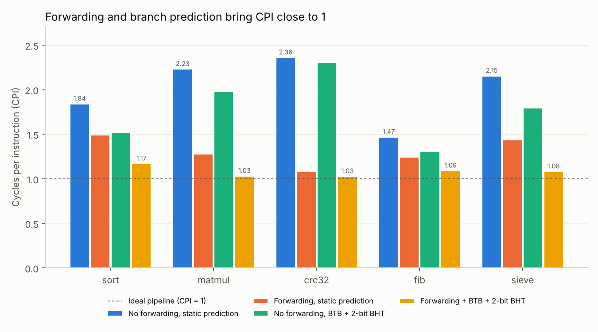
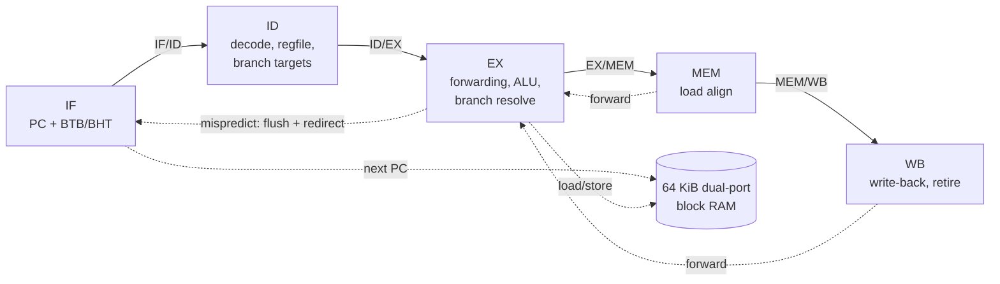

# riscv-cpu

A 5-stage pipelined **RV32I** processor in SystemVerilog with a dynamic branch
predictor, full forwarding, hardware performance counters and an industry-style
verification flow: lock-step co-simulation against a golden model, the official
RISC-V compliance tests, constrained-random program generation and mutation
testing. It runs C programs compiled with Clang and targets the DE10-Lite FPGA board.



## Highlights

- **CPI 1.03–1.17** on five C benchmarks, a **1.35–2.30x speed-up** over the same
  pipeline without forwarding and branch prediction (measured with the core's own
  cycle and instruction counters).
- **Passes all 41 applicable official `riscv-tests` (rv32ui)** with every retired
  instruction checked against an instruction-set simulator.
- **~200,000 random instructions** per regression run, compared one by one with the golden model.
- **14/14 injected pipeline bugs caught** by the test suite (mutation testing).
- **40.8 MHz** estimated Fmax after place-and-route (Lattice ECP5, open-source flow),
  up from 33.7 MHz after moving branch-target logic out of the critical path.
- Verilator-lint clean, CI on every push.

## Results

Benchmarks run their kernel between reads of the `cycle` / `instret` / mispredict /
stall counters. The four configurations are the same RTL with Verilog parameters
switched, so the differences come only from forwarding and branch prediction.

| Benchmark | What it stresses | No fwd, static | Fwd, static | No fwd, BTB+BHT | **Fwd + BTB+BHT** | Speed-up |
| --- | --- | ---: | ---: | ---: | ---: | ---: |
| sort | data-dependent branches, load-use | 1.839 | 1.490 | 1.517 | **1.168** | 1.57x |
| matmul | software multiply, nested loops | 2.229 | 1.280 | 1.979 | **1.029** | 2.17x |
| crc32 | shift/xor chains | 2.359 | 1.077 | 2.308 | **1.026** | 2.30x |
| fib | recursive calls and returns | 1.465 | 1.244 | 1.310 | **1.088** | 1.35x |
| sieve | byte stores, loops | 2.154 | 1.439 | 1.795 | **1.080** | 2.00x |

Values are cycles per instruction (lower is better). Full numbers, including
mispredictions per 1,000 instructions and stall cycles: [`results/perf.md`](results/perf.md).

What the numbers show:

- **Forwarding is the bigger win** for straight-line arithmetic (`crc32`: 2.36 -> 1.08).
- **Branch prediction matters most for loop-heavy code**; on its own it helps less
  because, without forwarding, dependency stalls dominate.
- **What is left** in the final configuration: `sort` loses 0.16 CPI to load-use
  stalls (it loads an element and compares it immediately), and `fib` mispredicts
  44 times per 1,000 instructions because one `ret` instruction returns to two
  different call sites. A return-address stack would fix the latter (see Next steps).

## Architecture



| Feature | Implementation |
| --- | --- |
| ISA | RV32I + Zicntr counters (read-only CSRs) + `fence.i` |
| Pipeline | IF, ID, EX, MEM, WB; in-order, single issue |
| Hazards | Forwarding from EX/MEM and MEM/WB, register-file write-through, 1-cycle load-use stall |
| Branches | 64-entry BTB + 2-bit BHT predict in IF; resolved in EX; 2-cycle mispredict penalty |
| Memory | 64 KiB true dual-port synchronous RAM (maps to FPGA block RAM) |
| I/O | UART TX (115200 8N1), 10 LEDs, 10 switches, memory-mapped at `0x1000_0000` |
| Counters | `cycle`, `instret`, mispredictions, stall cycles |

The full design walk-through, hazard table and timing analysis are in
[`docs/ARCHITECTURE.md`](docs/ARCHITECTURE.md).

## Verification

```
make test
  lint          Verilator -Wall
  test-unit     cocotb unit tests: ALU, immediates, register file, predictor
  test-isa      official riscv-tests rv32ui, co-simulated
  test-random   200 random programs, co-simulated
  test-sw       C programs and benchmarks, co-simulated
```

The testbench compares **every retired instruction** with a C++ instruction-set
simulator (`sim/iss.cpp`): PC, instruction, destination register and value,
and store address/size/data. Any difference stops the run at that instruction.

**Mutation testing** checks the tests themselves: each of 14 realistic bugs
(missing load-use stall, reversed forwarding priority, missing flush, wrong byte
lanes...) is injected into a copy of the RTL, and the suite must fail.

| Injected bug | riscv-tests failing | Random programs failing |
| --- | ---: | ---: |
| No load-use stall | 6 / 41 | 40 / 40 |
| Misprediction check ignores the predicted target | 0 / 41 | 40 / 40 |
| JALR does not clear bit 0 of the target | 0 / 41 | 40 / 40 |
| Load-use check ignores rs2 | 1 / 41 | 23 / 40 |
| *...10 more, all caught* | | |

Two of these bugs pass the official compliance tests completely; the random co-simulation
catches all of them. Details, including how the first version of the generator
missed two bugs and was improved: [`docs/VERIFICATION.md`](docs/VERIFICATION.md)
and [`results/mutation.md`](results/mutation.md).

## FPGA

**Open-source estimate** (`scripts/synth_ecp5.sh`: sv2v + Yosys + nextpnr, Lattice
ECP5-45F speed grade 6):

| Resource | Used |
| --- | ---: |
| Logic cells (LUT4) | 4,782 |
| Flip-flops | 1,028 |
| Block RAMs (DP16KD, 64 KiB RAM) | 67 |
| Fmax | 40.8 MHz |

**DE10-Lite (Intel MAX 10)**: `fpga/` contains the board wrapper, pin assignments and
timing constraints. The core runs at 25 MHz (50 MHz board clock divided by 2), the
firmware prints over the UART and mirrors the switches on the LEDs.

```
make -C sw fpga          # builds fpga/firmware.hex
# Quartus: open fpga/de10_lite.qsf, compile, program the board
# Connect a 3.3 V USB-UART adapter: RX -> Arduino header IO1, GND -> GND
# Open a terminal at 115200 baud and press KEY0 to reset
```

> The Quartus build has not been run on hardware yet; check the pin
> assignments against the DE10-Lite manual and the timing report before programming.

## Quick start

Requirements: Verilator 5, Clang/LLD with the RISC-V target (standard in LLVM),
Python 3, and for unit tests Icarus Verilog + `pip install cocotb pytest`.

```bash
# Ubuntu / WSL2
sudo apt install verilator iverilog clang lld llvm python3-pip
pip install cocotb pytest matplotlib

make run PROG=hello      # build the simulator and run a C program
make test                # full regression
make bench               # regenerate results/ (all four configurations)
make wave PROG=fib       # dump build/wave.vcd, open it with GTKWave
```

On macOS, install `verilator icarus-verilog llvm lld` with Homebrew and pass the
Homebrew Clang: `make -C sw RVCC=$(brew --prefix llvm)/bin/clang`.

```
$ make run PROG=hello
Hello from my RISC-V CPU!
LEDs = 0x00000080

[PASS] exit code 0 | cycles 521 | instret 438 | CPI 1.189 | mispredicts 17 | stall cycles 47 | cosim OK
```

## Repository layout

```
rtl/        SystemVerilog: core, ALU, decoder, hazard/forwarding units, predictor, RAM, UART, SoC
sim/        Verilator testbench (tb_main.cpp) and golden-model ISS (iss.cpp)
sw/         C runtime (crt0, linker script, printf-style helpers), examples, benchmarks
tests/      unit (cocotb), riscv-tests runner + environment, random program generator
scripts/    benchmarking, mutation testing, open-source synthesis, hex conversion
fpga/       DE10-Lite top level, pin assignments, timing constraints
docs/       architecture and verification write-ups
results/    generated performance and mutation-testing reports
```

## Next steps

- **Return-address stack** to remove most `fib` mispredictions.
- **Load data bypass**: load data already arrives at the start of MEM, so it could
  be forwarded straight into EX and remove most load-use stalls (`sort`).
- **Higher Fmax**: register the redirect (one more cycle of mispredict penalty) or
  add a fetch-address stage, trading CPI for clock speed, and measure the net effect.
- **M extension** (hardware multiply/divide) and a small instruction cache.
- **Traps and machine mode** so the full `riscv-tests` environment and an RTOS can run.

## License

MIT
