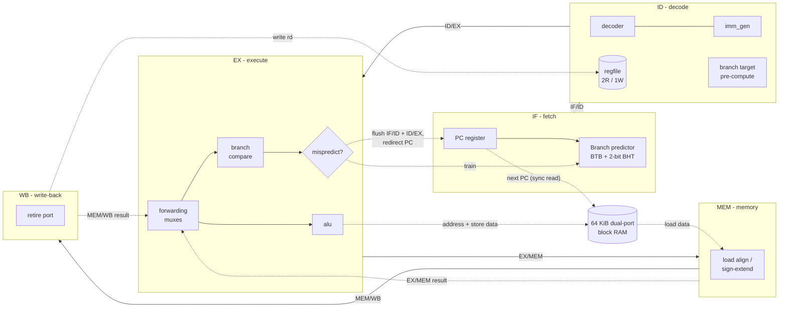

# Microarchitecture

This document walks through the core one stage at a time, then covers hazards,
branch prediction, the memory system and timing. File names refer to `rtl/`.

## Pipeline overview

| Stage | What happens | Key file |
| --- | --- | --- |
| IF | PC register; BTB/BHT lookup picks the next PC; the *next* PC is sent to the synchronous instruction RAM so the instruction for the current PC is ready at the start of IF | `core.sv`, `branch_predictor.sv` |
| ID | Decode, immediate generation, register read, and all branch-target arithmetic that does not depend on register values | `decoder.sv`, `imm_gen.sv`, `regfile.sv` |
| EX | Operand forwarding, ALU, branch condition, misprediction check, data-RAM address/store data, CSR (counter) reads | `alu.sv`, `forwarding_unit.sv` |
| MEM | Load data arrives from the synchronous RAM; byte/half selection and sign extension | `core.sv` |
| WB | Register write; the retirement port reports the committed instruction | `core.sv` |

## Hazards

| Hazard | Example | Handling | Cost |
| --- | --- | --- | --- |
| RAW, ALU result one ahead | `add x5,..` then `sub x6,x5,..` | Forward from EX/MEM | 0 cycles |
| RAW, two ahead | `add x5` / `nop` / `sub x6,x5` | Forward from MEM/WB | 0 cycles |
| RAW, three ahead | producer in WB, consumer in ID | Register file write-through bypass | 0 cycles |
| Load-use | `lw x5,0(a0)` then `add x6,x5,x7` | Hazard unit stalls ID one cycle, then forward from MEM/WB | 1 cycle |
| Control, predicted correctly | loop back-edge after warm-up | BTB/BHT redirects fetch in IF | 0 cycles |
| Control, mispredicted | first iteration, loop exit, changing return address | Resolve in EX, flush IF/ID + ID/EX | 2 cycles |
| Self-modifying code | store to code, then `fence.i` | `fence.i` flushes younger instructions and refetches | 2 cycles |
| Structural | - | Dual-port RAM: fetch and data never compete | none |

The `FORWARDING` parameter can disable the bypass network (the hazard unit then
waits for every producer to reach WB). The `BP_ENABLE` parameter replaces the
dynamic predictor with static not-taken. Both exist so their benefit can be
measured on the same RTL (see the README results).

## Branch prediction

* **BTB**: 64 entries, direct-mapped by `pc[7:2]`, full tag (`pc[31:8]`), stores
  the target and whether the entry is an unconditional jump.
* **BHT**: a 2-bit saturating counter per entry. A new taken branch starts as
  *weakly taken*, so a loop is predicted correctly from its second iteration.
* Not-taken branches are not allocated (a BTB miss already predicts not-taken),
  which keeps the table for branches that matter.
* Every control-flow instruction trains the predictor when it reaches EX.

A misprediction is: the wrong direction, or taken to the wrong target. All
target arithmetic happens in ID; EX only evaluates the branch condition, so the
check is cheap (see Timing). For `JALR` the check
`(rs1 + imm) & ~1 == predicted` is rewritten as
`rs1 == predicted - imm  ||  rs1 == predicted - imm + 1`, with both constants
prepared in ID, which removes an adder from the critical path.

## Memory system

* One 64 KiB **true dual-port** RAM (`ram_dp.sv`): port A fetches, port B
  loads/stores. Writing it in the standard inference template lets FPGA tools map
  it to block RAM.
* Both ports are **synchronous**, which is what block RAM provides:
  * fetch: the core presents the *next* PC, so the instruction is available
    for the current PC with no extra stage;
  * data: the address leaves at the end of EX; stores commit on that clock edge
    and load data is available during MEM. Nothing younger than a store can be
    flushed once it leaves EX (control flow resolves in EX), so committing stores
    there is safe.
* Peripherals are memory-mapped at `0x1000_0000` (UART, LEDs, switches,
  simulation exit) and their reads are registered to match the RAM latency.

## Performance counters

`cycle`, `instret` (Zicntr) plus two implementation-specific counters,
`hpmcounter3` (mispredictions) and `hpmcounter4` (data-hazard stall cycles), are
readable with `csrr`. Benchmarks read them around their kernel so start-up code
does not distort the numbers.

## Timing

`scripts/synth_ecp5.sh` runs an open-source flow (sv2v, Yosys, nextpnr) on a
Lattice ECP5-45F (speed grade 6) to get a vendor-independent estimate.

| Version | Critical path | Fmax |
| --- | --- | --- |
| First working pipeline | forwarding mux -> 32-bit compare of predicted vs actual next PC -> next-PC mux -> RAM address | 33.7 MHz |
| Target arithmetic moved to ID (current) | forwarding mux -> branch comparator -> next-PC mux -> RAM address | 40.8 MHz |

The remaining path is inherent to resolving branches in EX while addressing a
synchronous instruction RAM with the next PC; about two thirds of it is routing to
the block RAMs. The usual fixes are listed under "Next steps" in the README.

## Limitations (by design)

* No traps or privileged mode: `ecall`, `ebreak` and illegal instructions stop
  the simulation; misaligned loads/stores are not supported (the RISC-V spec
  allows either hardware support or a trap, and this core provides neither).
* CSR writes are ignored; only the counters are implemented.
* No M extension: multiplication and division are done in software
  (`sw/common/runtime.c`).
